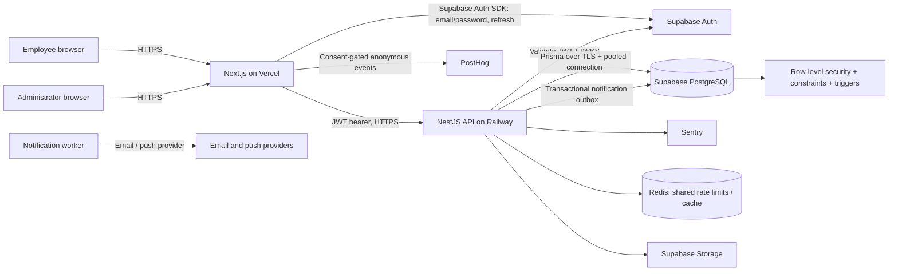
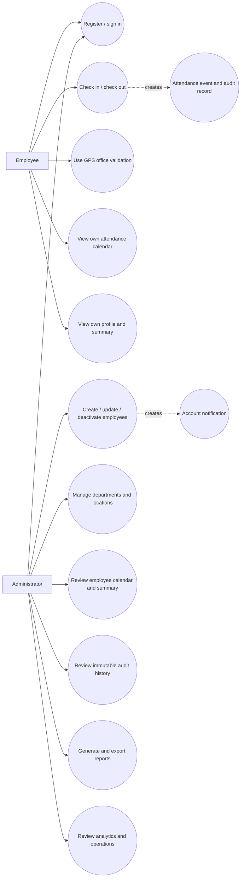
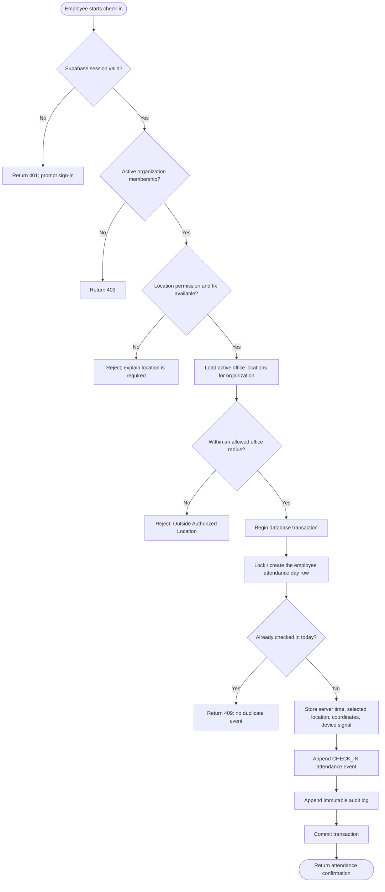
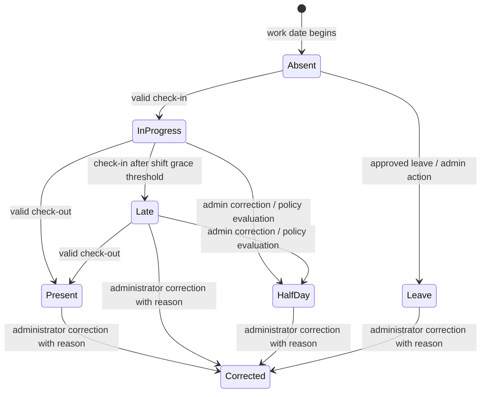
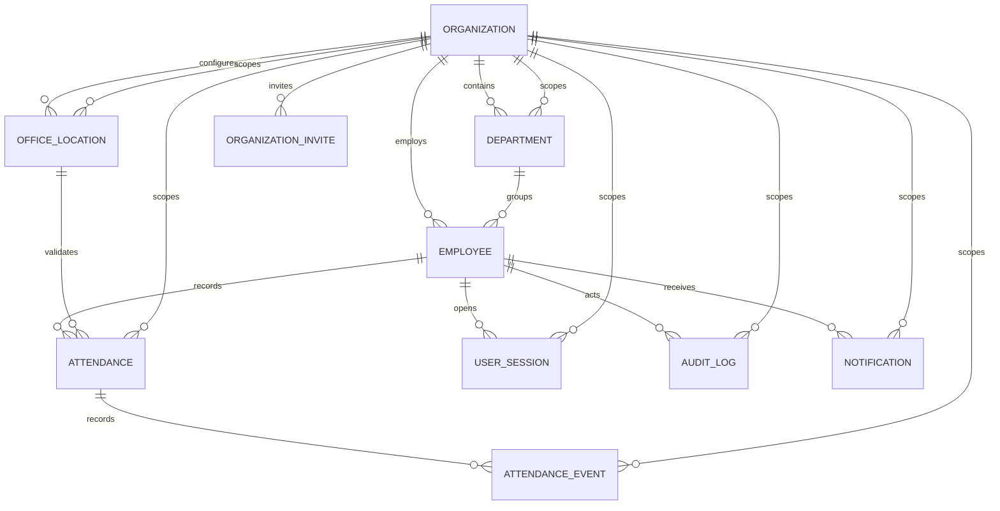
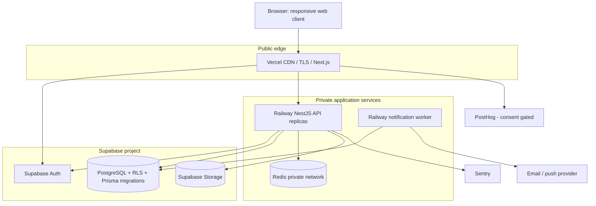
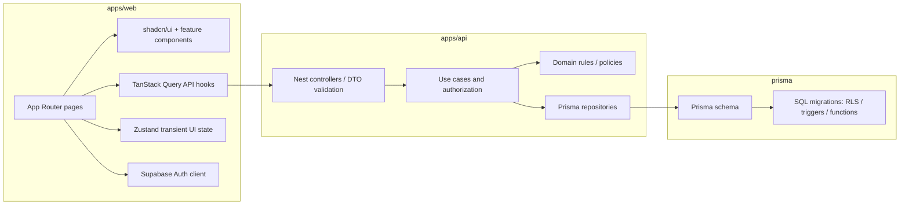
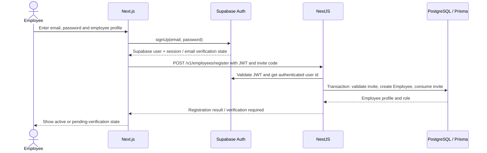

# AttendFlow architecture baseline

## Scope and decisions

This baseline follows the latest pasted request. The application serves two organization-scoped roles: **Employee** and **Administrator**. It covers employee registration and account access, attendance with office geofencing, attendance history/calendar, employee and department administration, immutable audit history, notifications, reports and analytics. The earlier 10,000-concurrent-user objective remains a capacity target; no throughput claim is made until a representative load test passes.

The stack is Next.js 15, React, TypeScript, Tailwind, shadcn/ui, TanStack React Query and Zustand; a NestJS TypeScript API; PostgreSQL on Supabase with Prisma; Supabase Auth; Supabase Storage for future user-approved attachments; Railway for the API; and Vercel for the web application. Redis remains the shared rate-limit/cache option from the earlier requirements. Sentry captures errors. PostHog is opt-in and receives coarse product events only; it must not receive attendance, location, employee identity, email or device data.

### Current workspace assessment

The repository contains an early Next.js/NestJS UI and a legacy Supabase-JS API alongside the Prisma data model. The Prisma-backed workforce controller is an initial module; the legacy UI/API and Prisma API are not fully integrated. Static files and `attendflow-zip/` are not application modules.

## High-level architecture



## Use-case diagram



## Activity diagram: employee check-in



## State diagram: daily attendance record



`InProgress` is an operational state while a workday is open. The persisted business statuses are `PRESENT`, `ABSENT`, `LATE`, `LEAVE`, `HALF_DAY`, and `REMOTE_WORK`, with an internal `IN_PROGRESS` state so the dashboard never guesses whether an employee is still clocked in.

## ER diagram



## Deployment diagram



## Package diagram



## Sequence diagram: registration and activation



## Target API contracts

The following contract is the planned complete API. Only the initial `/api/v1/workforce/*` routes documented below are currently implemented; do not treat the entire table as live.

All application endpoints use `/v1`, JSON, HTTPS and a Supabase access token in `Authorization: Bearer <JWT>`. The API obtains identity from a verified token. Employee and organization IDs in request bodies are never treated as authorization proof. Mutations use `Idempotency-Key` for attendance writes. Errors use `{ "code": "...", "message": "...", "requestId": "..." }`.

| Method and path | Role | Contract summary |
|---|---|---|
| `POST /v1/employees/register` | Authenticated invitee | `{ inviteCode, employeeId, fullName, phone, departmentId?, designation }`; binds profile to verified Supabase user, consumes invite once |
| `GET /v1/me` | Employee/Admin | Own employee profile and effective organization role |
| `GET /v1/employees` | Admin | Paginated, filterable employee directory |
| `POST /v1/employees` | Admin | Create invite and employee record; account activation completes via registration |
| `GET /v1/employees/:id` | Admin or self | Profile and summary, with tenant and self checks |
| `PATCH /v1/employees/:id` | Admin | Update validated profile fields; old/new values audited |
| `DELETE /v1/employees/:id` | Admin | Soft-deactivate; never hard-delete attendance or audit history |
| `GET/POST/PATCH /v1/departments` | Admin for writes | Organization-scoped department list and maintenance |
| `GET/POST/PATCH /v1/locations` | Admin for writes | Office name, latitude, longitude, radius (meters), active state |
| `POST /v1/attendance/check-in` | Employee | `{ latitude, longitude, accuracyMeters, attendanceType }`; server validates radius and duplicate/state rules |
| `POST /v1/attendance/check-out` | Employee | `{ latitude?, longitude? }`; server timestamp; returns duration and status |
| `GET /v1/attendance/me?from&to` | Employee | Own calendar records and daily totals |
| `GET /v1/employees/:id/attendance?from&to` | Admin or self | Calendar rows, role-filtered |
| `POST /v1/attendance/:id/corrections` | Admin | `{ reason, checkInAt?, checkOutAt?, status }`; preserves original values and audits change |
| `GET /v1/employees/:id/summary?from&to` | Admin or self | Present/absent/leave/late days and average hours |
| `GET /v1/audit-logs` | Admin | Filtered, cursor-paginated, read-only events |
| `GET /v1/reports/attendance?from&to&departmentId?&format` | Admin | Daily/monthly/department/history; CSV, XLSX or PDF |
| `GET /v1/analytics/attendance?period` | Admin | Aggregated daily/monthly/department/late-arrival series; no employee GPS coordinates |
| `POST /v1/notifications/:id/retry` | Admin/system worker | Retry delivery from outbox with bounded backoff |
| `GET /health/live`, `GET /health/ready` | Public / internal | Liveness and dependency readiness; no secrets in output |

Authentication registration/login/password reset use Supabase Auth SDK. Backend employee registration attaches business profile data to the verified Supabase identity; passwords are never stored in the application database. OAuth providers are an optional later phase because the latest request specifies email/password.

### Attendance invariants

1. The API server/database clock is authoritative. Client timestamps are ignored.
2. One employee has at most one daily record per organization work date in Phase 1. The unique constraint is `(organizationId, employeeId, workDate)`.
3. Check-out requires an open check-in; duplicate check-in/out returns conflict and does not create duplicate events.
4. GPS must include a fresh accuracy value within configured bounds. Distance uses a server-side geodesic calculation against active organization locations and their individual radii.
5. The server chooses the matching office location; it never trusts a client-submitted location ID as proof of proximity.
6. The initial Prisma check-in and check-out routes write the attendance row, attendance event and audit log in one transaction. Notification outbox delivery is designed but not yet connected to these routes.
7. Attendance correction requires an administrator reason and keeps old/new snapshots in an append-only audit event.

## Intended data ownership and security model

- Supabase Auth owns credentials, password hashing, email verification, refresh-token rotation and recovery. Prisma owns business data only.
- `Employee.supabaseUserId` is unique and references `auth.users(id)` in SQL. The API validates the JWT and maps it to exactly one active organization employee.
- Every tenant-owned row includes `organizationId`. Unique keys and foreign keys carry organization scope where relevant.
- PostgreSQL RLS is enabled for tenant tables. The current Prisma controller checks organization membership and admin roles in Nest; it does not yet set transaction-local JWT claims for PostgreSQL or execute under a dedicated non-bypass RLS database role. Production deployment must not use a database owner credential for request handling until that boundary is implemented.
- Admin authorization is checked in Nest use cases and reinforced in RLS. Hiding controls in React is never authorization.
- `audit_logs` and `attendance_events` are append-only: application grants omit update/delete; SQL triggers reject mutation. Soft-deactivation preserves history.
- GPS data is collected for the attendance check only. Keep raw coordinates only on attendance events when the company policy requires it, restrict access, and set retention. Hash IP addresses with a rotating server secret; never persist raw IP by default.
- Browser, device and GPS values are untrusted client signals and cannot be used as MFA or cryptographic device attestation.
- Rate limiting is shared across API replicas. Use Redis or a Railway edge/gateway implementation; in-memory-only throttling is not acceptable for production.
- Employee activity monitoring records sign-in/out and attendance/system actions. It does not capture keystrokes, page contents or unrelated browsing.

## Planned repository structure

```text
apps/
  web/                         Next.js employee/admin experience
    app/                       App Router routes, layouts and server boundaries
    components/ui/             shadcn/ui primitives
    features/attendance/       Calendar, check-in, history and query hooks
    features/employees/        Employee directory and detail views
    features/reports/          Filters and export actions
    lib/                       Supabase browser client, typed API client
  api/
    src/auth/                  JWT validation and request identity
    src/common/                validation, errors, rate limits, request IDs
    src/employees/             controllers, use cases, policies, DTOs
    src/departments/
    src/locations/
    src/attendance/
    src/audit/
    src/reports/
    src/notifications/
    src/analytics/
    src/prisma/                Prisma module and transaction context
prisma/
  schema.prisma               Normalized source of truth for data model
  migrations/                 Versioned PostgreSQL DDL, RLS, triggers and functions
docs/                         Architecture, API contracts, rollout/runbooks
infra/                        Railway/Vercel/monitoring configuration
```

`apps/api/src/attendance.controller.ts`, `supabase.service.ts`, and dashboard components still implement an earlier Supabase schema. `apps/api/src/workforce.controller.ts` and `prisma.service.ts` are the initial Prisma-backed module. Split controllers into domain modules and complete the API/UI integration before production use.

## Implemented Prisma API (initial module)

All routes are prefixed with `/api/v1`, require a valid Supabase bearer token, and derive the employee from the authenticated Supabase user ID. The API validates membership and role in the selected organization.

| Method and path | Access | Purpose |
|---|---|---|
| `GET /api/v1/workforce/me` | Employee/Admin | List the signed-in user's active employee profiles and organizations. |
| `POST /api/v1/workforce/invites/:organizationId` | Admin | Create a seven-day, single-use invitation; returns the one-time raw code. |
| `POST /api/v1/workforce/invites/:organizationId/redeem` | Authenticated invitee | Redeem an invite for the matching verified email and create the employee profile. |
| `GET /api/v1/workforce/:organizationId/dashboard?date=` | Admin | Return daily records and present, absent, WFH and late totals. |
| `GET /api/v1/workforce/:organizationId/attendance?from=&to=&employeeId=` | Employee/Admin | Query own history or an admin-filtered organization date range. |
| `POST /api/v1/workforce/attendance/check-in` | Employee | Validate GPS accuracy and office radius, or approved WFH permission; write record, event and audit log. |
| `POST /api/v1/workforce/attendance/check-out` | Employee | Office check-out requires GPS coordinates/accuracy and radius validation; WFH close does not require GPS. Writes event and audit log. |
| `POST /api/v1/workforce/:organizationId/departments` | Admin | Create a department. |
| `POST /api/v1/workforce/:organizationId/locations` | Admin | Create an office geofence. |
| `GET /api/v1/workforce/:organizationId/employees` | Admin | List organization employees. |
| `PATCH /api/v1/workforce/:organizationId/employees/:employeeId/wfh` | Admin | Set an employee's WFH permission with an audit record. |
| `POST /api/v1/workforce/:organizationId/attendance/:attendanceId/correction` | Admin | Correct check-in/out timestamps with a required reason and audit record. |
| `GET /api/v1/health/ready` | Public/internal | Check PostgreSQL connectivity. |

These routes are an initial slice, not feature-complete API coverage. Employee editing/deactivation, department/location update, calendar-specific aggregation, monthly/yearly report exports, idempotency, transaction-local RLS context, and the remaining dashboard UI integration are outstanding.

## Implementation order

1. **Architecture and contracts (current):** requirement baseline, eight diagrams, role boundaries, API contract and folder structure.
2. **Phase 1 — Database:** Prisma schema, normalized PostgreSQL migration, constraints/indexes, RLS, immutable audit/event triggers, attendance transaction functions, seed strategy and migration documentation.
3. **Phase 2 — Backend foundation:** Nest modules, Prisma service, transaction-local RLS context, request identity, DTO validation, error shape, health, Redis-backed rate limits and audit context.
4. **Phase 3 — Authentication and employee lifecycle:** Supabase email/password, registration/invite activation, employee/admin role binding, recovery and session history.
5. **Phase 4 — Attendance:** geofence check-in/out, statuses, hours, idempotency and calendar APIs.
6. **Phase 5 — Admin dashboard:** employee/department/location administration, employee details, calendar, summary, access boundaries and responsive UI.
7. **Phase 6 — Audit and notifications:** immutable logs, transactional outbox, email/push adapter and delivery status/retry handling.
8. **Phase 7 — Reports and analytics:** daily/monthly/department reports, PDF/XLSX/CSV, privacy-safe aggregates.
9. **Phase 8 — Monitoring and hardening:** Sentry, opt-in PostHog, structured logs, dashboards, security review, backups/retention and load tests against the 10,000-user target.
10. **Phase 9 — Deployment:** Supabase migration, Railway API/worker, Vercel frontend, production secrets/domains/CORS, health checks and release rollback runbook.

## Files created in the architecture and database phase

- `docs/architecture.md`: requirements baseline, diagrams, contracts, security model, target tree and phase plan.
- `prisma/schema.prisma`: normalized Prisma data model used by the API and migrations.
- `prisma/migrations/202611130001_initial_workforce_schema/migration.sql`: initial Supabase PostgreSQL schema and database-enforced invariants.
- `apps/api/package.json`: Prisma runtime/generator dependencies and schema scripts.
